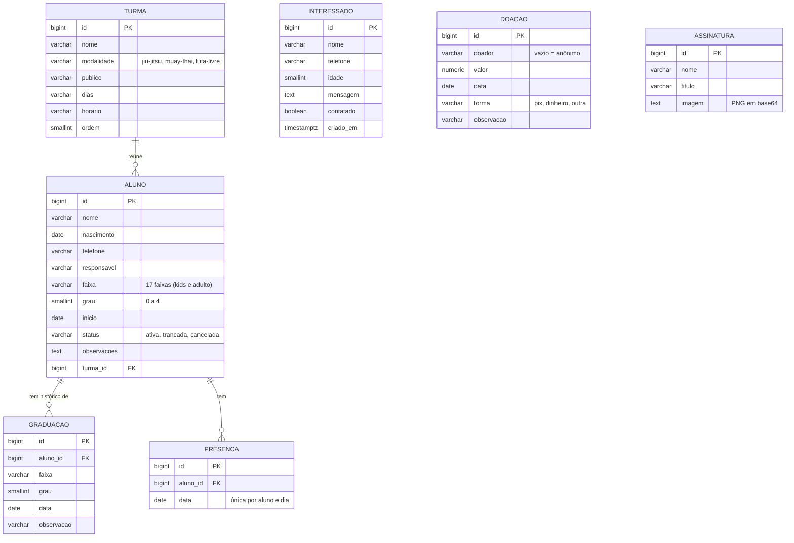

# Diagrama do banco de dados

Banco: **PostgreSQL no Supabase** (em desenvolvimento local o Django usa SQLite com as mesmas tabelas).

## Como as tabelas se ligam
- **Turma → Aluno:** uma turma tem vários alunos. Se a turma for apagada, os alunos ficam sem turma (não são apagados).
- **Aluno → Troca de faixa (Graduação):** cada troca de faixa fica no histórico. Ao registrar, a faixa e o grau do aluno são atualizados sozinhos.
- **Aluno → Presença:** uma linha por aluno e por dia. A combinação aluno + data é única, então a mesma presença não se repete.
- **Interessado, Doação e Assinatura** não dependem das outras tabelas.

Também existem as tabelas do próprio Django (usuários, sessões, histórico do painel). Todas as tabelas ficam protegidas no Supabase (RLS ligado, sem acesso pela API pública).
